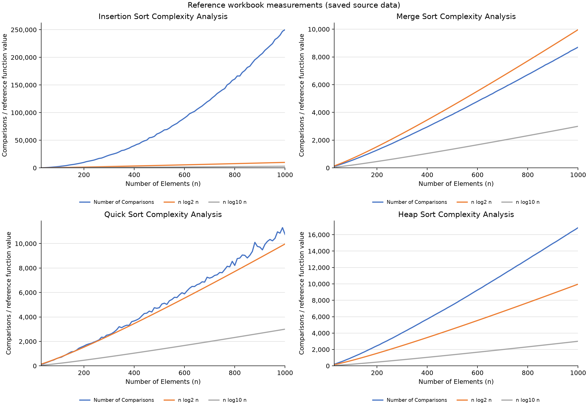

# Design and Analysis of Algorithms in C++17

This lab contains **17 standalone C++17 programs**, including ten sorting
experiments and examples and seven other algorithm practicals. Each program
has its own `main()` and compiles separately.

## Contents

| Folder | Includes |
|---|---|
| [sorting/](sorting/) | Insertion, merge, quick, heap, counting, radix and bucket sorting labs; three simpler sorting examples; Excel workbooks, graphs, saved results and correction notes |
| [daa/](daa/) | Strassen, BFS, DFS, Prim, Dijkstra, weighted interval scheduling and 0/1 knapsack; sample inputs/outputs and tests |

## Sorting programs

| Program | Source |
|---|---|
| Insertion comparison experiment | [sorting/lab/lab1.cpp](sorting/lab/lab1.cpp) |
| Merge comparison experiment | [sorting/lab/lab2.cpp](sorting/lab/lab2.cpp) |
| Quick comparison experiment | [sorting/lab/lab3.cpp](sorting/lab/lab3.cpp) |
| Heap comparison experiment | [sorting/lab/lab4.cpp](sorting/lab/lab4.cpp) |
| Counting sort and timing | [sorting/lab/lab5.cpp](sorting/lab/lab5.cpp) |
| Radix sort and timing | [sorting/lab/lab6.cpp](sorting/lab/lab6.cpp) |
| Bucket sort and timing | [sorting/lab/lab7.cpp](sorting/lab/lab7.cpp) |
| Bubble sort example | [sorting/Sorting/bubbleSorst.cpp](sorting/Sorting/bubbleSorst.cpp) |
| Insertion sort example | [sorting/Sorting/insertionSort.cpp](sorting/Sorting/insertionSort.cpp) |
| Merge sort example | [sorting/Sorting/mergesort.cpp](sorting/Sorting/mergesort.cpp) |

Browse the [PNG and SVG graphs](sorting/graphs/), [Excel workbooks](sorting/lab/),
and [CSV results](sorting/results/). The [results report](sorting/REPORT.md)
explains the saved measurements. Fresh random runs may produce different
comparison counts.



## Other DAA programs

| Experiment | Source |
|---|---|
| 1. Strassen's matrix multiplication | [daa/programs/01_strassen.cpp](daa/programs/01_strassen.cpp) |
| 2. Breadth-first search | [daa/programs/02_bfs.cpp](daa/programs/02_bfs.cpp) |
| 3. Depth-first search | [daa/programs/03_dfs.cpp](daa/programs/03_dfs.cpp) |
| 4. Prim's minimum spanning tree | [daa/programs/04_prim.cpp](daa/programs/04_prim.cpp) |
| 5. Dijkstra's shortest paths | [daa/programs/05_dijkstra.cpp](daa/programs/05_dijkstra.cpp) |
| 6. Weighted interval scheduling | [daa/programs/06_weighted_interval_scheduling.cpp](daa/programs/06_weighted_interval_scheduling.cpp) |
| 13. 0/1 knapsack | [daa/programs/13_zero_one_knapsack.cpp](daa/programs/13_zero_one_knapsack.cpp) |

See the [DAA README](daa/README.md) for inputs, outputs and complexity, and the
[BFS/DFS correction log](daa/BFS_DFS_ALIGNMENT.md) for the reference alignment.
The requested experiment numbering is preserved. BFS/DFS and sorting use built-in
demonstration inputs. The other five DAA programs read standard input.

## Build and test everything

Requirements: a C++17 compiler, Make and Python 3.10+.
No third-party Python packages are needed for compilation or correctness tests.

```sh
make all
make test
make sanitize
```

`make test` runs both existing test suites. `make sanitize` checks both sets
with AddressSanitizer and UndefinedBehaviorSanitizer. GitHub Actions runs these
same combined checks. Use `CXX=clang++` or `CXX=g++` to select a compiler, and
`PYTHON=/path/to/python3` to select Python.

Ordinary DAA checks retain their 30-second per-program timeout. Sanitizer runs
allow 120 seconds per DAA program; override this with
`make sanitize SANITIZER_TIMEOUT_SECONDS=180` if needed. Direct DAA test runs
accept the same budget through `DAA_PROGRAM_TIMEOUT_SECONDS`.

Compile and run any one program directly from the repository root:

```sh
mkdir -p daa/build
c++ -std=c++17 -O2 daa/programs/05_dijkstra.cpp -o daa/build/05_dijkstra
./daa/build/05_dijkstra < daa/samples/05_dijkstra.in

mkdir -p sorting/build
c++ -std=c++17 -O2 sorting/lab/lab1.cpp -o sorting/build/lab1
./sorting/build/lab1
```

Do not link the separate programs into one executable. On Windows, compile the
canonical `.cpp` files directly and use an `.exe` filename; the sorting `src/`
aliases are optional and do not require Windows symlink support for these commands.

To regenerate the sorting graph exports, install their optional plotting dependency:

```sh
python3 -m venv .venv
.venv/bin/python -m pip install -r sorting/requirements.txt
make graphs PYTHON=.venv/bin/python
```

The original folder-specific instructions still work when run from within their
respective folder. Build artifacts are ignored by Git. `make clean` removes them.

## Imported versions and attribution

The sorting labs, workbook data, and BFS and DFS examples draw on the
[reference algorithm repository by Aayush-data-eng](https://github.com/Aayush-data-eng/Design-And-Analysis-of-Algorithm/tree/fb018e38df9ed2223aa6991af28c2b7294e8912f).
The [sorting corrections](sorting/REFERENCE_ALIGNMENT.md) and
[BFS and DFS corrections](daa/BFS_DFS_ALIGNMENT.md) document adaptations.
[SOURCE_REPOSITORIES.json](SOURCE_REPOSITORIES.json) records the original
repository names and source commits.
